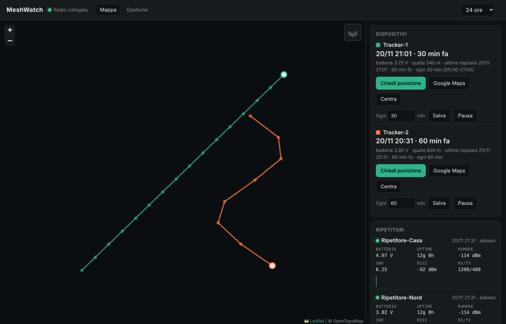

# MeshWatch

Dashboard self-hosted per reti **MeshCore**: segue la posizione GPS di uno o più dispositivi (per esempio un SenseCAP T1000-E), monitora i ripetitori e si gestisce da una pagina web in rete locale o da un **bot Telegram** quando si è fuori casa.

Gira su un Raspberry Pi con una radio MeshCore in modalità *Companion USB* (Heltec V3, RAK, …) collegata via USB.

*Self-hosted dashboard for MeshCore networks: GPS tracking of companion devices via telemetry requests, repeater monitoring and remote CLI, local web UI and Telegram bot. Runs on a Raspberry Pi with a USB companion radio. Documentation is in Italian.*



## Cosa fa

- **Tracciamento GPS**: a intervalli regolari chiede la telemetria ai dispositivi scelti e salva la traccia. Più dispositivi, ognuno con il suo colore, intervallo, fascia oraria e soglie di avviso.
- **Pulizia tracce**: dal cestino sulla mappa (tutti i dispositivi) o da "Cancella traccia" (uno solo) si eliminano i punti salvati; resta l'ultima posizione. Solo admin.
- **Ripetitori**: login e statistiche periodiche (batteria, uptime, rumore, SNR, RSSI, pacchetti) con grafico della batteria.
- **Terminale**: comandi CLI ai ripetitori dalla pagina o da Telegram, con conferma per i comandi che modificano o riavviano e registro di tutti i comandi inviati.
- **Gateway**: stato e configurazione della radio collegata (nome, potenza, posizione, parametri radio), advert, riavvio.
- **Sistema**: temperatura, memoria, disco, **avviso di tensione bassa**, riavvio e spegnimento del Raspberry.
- **Telegram**: posizione con pin e link Google Maps, ultima posizione, traccia, stato dei nodi, avvisi (dispositivo che non risponde, batteria bassa, ripetitore muto).
- **Da telefono**: pagina pensata anche per lo smartphone (barra in basso Mappa · Nodi · Gestione).
- **Aggiornamento dalla pagina**: scarica l'ultima versione da GitHub e riavvia, senza togliere la SD; se la nuova versione non parte torna da sola alla precedente.
- **Utenti**: ruoli *admin* (gestisce tutto) e *viewer* (vede e chiede la posizione), predisposto per l'accesso da Internet tramite Cloudflare Tunnel.

| Gestione | Sistema e gateway |
|---|---|
|  |  |

## Come funziona

```
Dispositivo GPS ─LoRa─ ripetitori ─LoRa─ Heltec (Companion USB) ─USB─ Raspberry Pi ─┬─ pagina web (rete di casa)
                                                                                  └─ bot Telegram (ovunque)
```

MeshWatch usa la [libreria Python ufficiale `meshcore`](https://pypi.org/project/meshcore/). La posizione si ottiene con richieste di **telemetria**: il dispositivo da seguire deve permettere al gateway di leggerla (nell'app MeshCore: gateway tra i *preferiti*, telemetria posizione "solo preferiti").

## Installazione

### Metodo 1 — SD pronta con DietPi (consigliato, da Windows)

Nella cartella [`sd-kit/`](sd-kit/) c'è tutto per creare una scheda che si installa da sola al primo avvio. Istruzioni passo passo in [`sd-kit/LEGGIMI.txt`](sd-kit/LEGGIMI.txt).

1. Scarica DietPi per Raspberry Pi (ARMv8 64-bit per Pi 3/4/5, ARMv7 per Pi 2) e scrivilo sulla SD con balenaEtcher.
2. Doppio clic su `sd-kit/PREPARA-SD.bat`: chiede nome, password e WiFi, copia MeshWatch sulla SD e apre il config.
3. Inserisci la SD nel Raspberry con la radio collegata e accendi: in 20–30 minuti è pronto su `http://meshwatch.local:8080`.

Accesso SSH con l'utente `meshwatch` (root disabilitato via SSH). Per aggiornare: dalla pagina (vedi [Aggiornamenti](#aggiornamenti)); in alternativa SD nel PC e `sd-kit/AGGIORNA-SD.bat`. Config e dati restano.

### Metodo 2 — su un Raspberry Pi OS esistente

```bash
git clone https://github.com/davide-brugnoni/meshwatch.git
cd meshwatch
bash install.sh
nano config.yaml
sudo systemctl start meshwatch
```

### Requisiti

- Raspberry Pi 2/3/4/5 (o qualsiasi Linux con Python 3.11+)
- radio MeshCore con firmware **Companion USB**
- alimentatore adeguato (5,1 V 2,5 A per il Pi 3): con tensione bassa la rete e la USB diventano instabili

## Configurazione

Copia `config.example.yaml` in `config.yaml` (con il kit SD il file è `meshwatch-config.yaml` sulla scheda).

- `serial_port: auto` trova da solo la radio.
- `telegram.token`: crealo con @BotFather. `allowed_chat_ids`: chi può usare il bot e riceve gli avvisi; `admin_chat_ids`: chi può usare il terminale. Il tuo ID te lo dà @userinfobot.
- Le sezioni `tracker` e `repeaters` vengono importate solo al primo avvio: poi dispositivi, ripetitori e utenti si gestiscono dalla pagina (scheda **Gestione**).

### Comandi Telegram

| Comando | Cosa fa |
|---|---|
| `/posizione` | chiede subito la posizione (pin + link Google Maps) |
| `/ultima` · `/traccia` | ultima posizione · punti delle ultime 12 ore |
| `/nodi` · `/aggiorna` | stato di dispositivi e ripetitori · interroga subito i ripetitori |
| `/intervallo 30` · `/pausa` · `/riprendi` | gestione del tracciamento |
| `/advert` | il gateway si annuncia sulla mesh |
| `/terminale` · `/fine` | comandi CLI a un ripetitore |

Con più dispositivi il bot chiede quale con dei pulsanti.

### Riavvio e spegnimento dalla pagina

Il servizio gira senza privilegi. Il kit SD abilita da solo i due comandi necessari; su installazioni manuali o precedenti:

```bash
echo 'meshwatch-svc ALL=(root) NOPASSWD: /usr/bin/systemctl reboot, /usr/bin/systemctl poweroff' | sudo tee /etc/sudoers.d/meshwatch && sudo chmod 440 /etc/sudoers.d/meshwatch && sudo visudo -cf /etc/sudoers.d/meshwatch
```

(con `install.sh` l'utente del servizio è il tuo utente invece di `meshwatch-svc`: lo script lo configura da solo).

## Aggiornamenti

Dalla pagina: **Gestione → Aggiornamento programma → Controlla aggiornamenti → Aggiorna ora**. Il Raspberry deve raggiungere `api.github.com` e `codeload.github.com`.

Cosa succede:

1. scarica l'ultimo commit del ramo `main` (con `install.sh` da un clone git: `git fetch` + `merge --ff-only`);
2. controlla che il pacchetto sia completo e che il codice Python compili;
3. se `requirements.txt` è cambiato aggiorna le librerie nel venv;
4. mette da parte la versione attuale in `.update/backup`, installa la nuova e riavvia il servizio (circa un minuto: pagina e bot non rispondono);
5. se la nuova versione non resta accesa 90 secondi per 3 avvii di fila, `tools/guard.sh` (eseguito da systemd prima di ogni avvio) rimette la precedente e la pagina lo segnala.

`config.yaml`, database, utenti e venv non vengono toccati. Repository e ramo si possono cambiare con la sezione `update:` del config.

**Schede preparate prima della versione 1.1** (una volta sola): il programma era di proprietà di root e il servizio non poteva aggiornarsi. Con il Raspberry acceso e in rete, doppio clic su `sd-kit/ABILITA-AGGIORNAMENTI.bat` da Windows, oppure via SSH:

```bash
curl -fsSL https://raw.githubusercontent.com/davide-brugnoni/meshwatch/main/tools/abilita-aggiornamenti.sh | sudo bash
```

Installa l'ultima versione e riconfigura il servizio (`tools/configura-servizio.sh`). Da quel momento la SD non va più tolta per aggiornare.

Con `install.sh` (Metodo 2) l'aggiornamento dalla pagina funziona se la cartella è un clone git: rilancia `bash install.sh` una volta per aggiungere la protezione `guard.sh` al servizio.

L'aggiornamento da SD (`AGGIORNA-SD.bat`) resta possibile: lascia sulla SD il file `meshwatch/AGGIORNA` e al riavvio il Raspberry copia la nuova versione.

## Accesso da Internet

1. Crea un utente admin dalla pagina (Gestione → Utenti): da quel momento la pagina chiede il login.
2. Nel config: `web.mode: public` e `web.host: 127.0.0.1`.
3. Cloudflare Zero Trust → *Tunnels* → crea un tunnel, installa `cloudflared` sul Raspberry con il comando proposto, *Public hostname* `mesh.tuodominio.it` → `http://localhost:8080`.
4. Consigliato: *Access → Applications* con policy per email, come secondo lucchetto.

In modalità `public` il login è obbligatorio, i cookie viaggiano solo su HTTPS e dopo 8 tentativi errati l'IP viene bloccato per 15 minuti. La pagina mostra la posizione di persone in tempo reale: non esporla mai senza login.

## Limiti

- Se il dispositivo è dove nessun ripetitore lo sente, la richiesta va a vuoto: resta l'ultima posizione con l'orario.
- Ogni richiesta occupa la radio per qualche secondo: intervalli sotto i 10 minuti non sono consigliati.
- Il dispositivo tracciato deve rispondere alla telemetria anche senza telefono collegato: va verificato sul campo.

## Struttura

```
meshwatch/            pacchetto Python
  __main__.py         avvio (python -m meshwatch -c config.yaml)
  mesh.py             comunicazione con la radio (libreria meshcore)
  core.py             interrogazioni periodiche, avvisi, stato
  db.py               SQLite: dispositivi, posizioni, ripetitori, utenti, impostazioni
  web.py              API FastAPI e pagina
  bot.py              bot Telegram
  auth.py             login e sessioni
  system.py           stato del Raspberry, riavvio/spegnimento
  updater.py          aggiornamento dalla pagina (GitHub), con ripristino
web/index.html        interfaccia (Leaflet incluso in web/vendor)
tools/                guard.sh (ripristino), configura-servizio.sh, abilita-aggiornamenti.sh
sd-kit/               preparazione e aggiornamento della SD DietPi da Windows
install.sh            installazione manuale su Raspberry Pi OS / Debian
tests/                test con radio simulata
```

## Sviluppo

```bash
python3 -m venv venv && ./venv/bin/pip install -r requirements.txt httpx
./venv/bin/python tests/test_smoke.py
./venv/bin/python tests/test_update.py
```

## Licenza

MIT — vedi [LICENSE](LICENSE).
