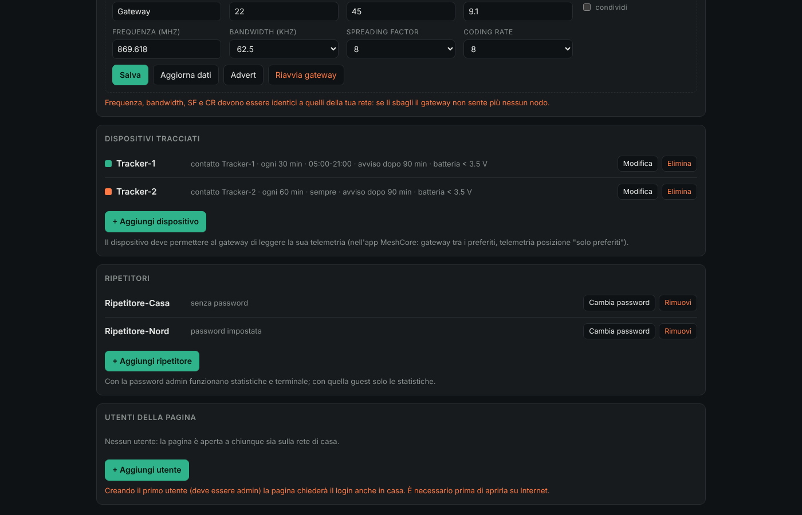
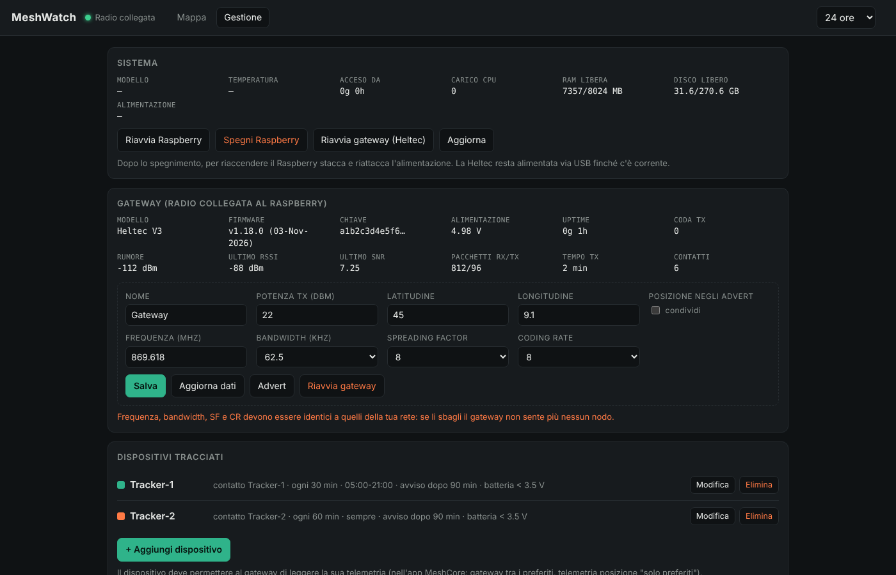

# MeshWatch

[](https://github.com/davide-brugnoni/meshwatch/actions/workflows/test.yml)

Dashboard self-hosted per reti **MeshCore**: segue la posizione GPS di uno o più dispositivi (per esempio un SenseCAP T1000-E), monitora i ripetitori e si gestisce da una pagina web in rete locale o da un **bot Telegram** quando si è fuori casa.

Gira su un Raspberry Pi con una radio MeshCore in modalità *Companion USB* (Heltec V3, RAK, …) collegata via USB.

*Self-hosted dashboard for MeshCore networks: GPS tracking of companion devices via telemetry requests, repeater monitoring and remote CLI, local web UI and Telegram bot. Runs on a Raspberry Pi with a USB companion radio. Documentation is in Italian.*


## Cosa fa

- **Tracciamento GPS**: a intervalli regolari chiede la telemetria ai dispositivi scelti e salva la traccia. Più dispositivi, ognuno con il suo colore, intervallo, fascia oraria e soglie di avviso.
- **Intervallo adattivo**: facoltativo, per dispositivo. Se tra due posizioni si è spostato più di 150 m viene interrogato più spesso; quando si ferma torna all'intervallo normale.
- **Pulizia tracce**: dal cestino sulla mappa (tutti i dispositivi) o da "Cancella traccia" (uno solo) si eliminano i punti salvati; resta l'ultima posizione. Solo admin.
- **Sensori**: tutti i valori della telemetria (temperatura, umidità, pressione, luce, tensione, …) salvati a ogni risposta, anche senza fix GPS, con grafico per sensore e **soglie di avviso** su Telegram.
- **Percorso dei pacchetti**: per ogni risposta i ripetitori attraversati (*via Rip-Monte → Rip-Valle*), disegnati sulla mappa dal gateway al dispositivo; percorso anche per ogni contatto della rubrica.
- **Mappa della copertura**: celle colorate dove il dispositivo risponde e dove no, con salti medi: mostra dove manca un ripetitore.
- **Ripetitori**: login e statistiche periodiche (batteria, uptime, rumore, SNR, RSSI, pacchetti) con grafici di batteria, rumore, SNR e RSSI.
- **Chat**: messaggi privati e canali (Public e canali privati) direttamente dalla Heltec collegata al Raspberry, dalla pagina, senza accendere un altro dispositivo. Conferma di consegna, nuovi tentativi automatici, messaggi salvati anche a pagina chiusa.
- **Mappa della rete**: livello "Rete MeshCore" con i nodi che annunciano la posizione e i collegamenti tra ripetitori vicini colorati per SNR.
- **Rubrica del gateway**: contatti della Heltec con salti, posizione e ultimo advert; preferiti, azzera percorso, rimuovi, aggiunta manuale dei nuovi nodi.
- **Mappe a scelta**: CARTO chiara e scura, OpenStreetMap, CyclOSM, OpenTopoMap, satellite Esri (con o senza nomi). La scelta resta salvata nel browser.
- **Terminale**: comandi CLI ai ripetitori dalla pagina o da Telegram, con conferma per i comandi che modificano o riavviano e registro di tutti i comandi inviati.
- **Gateway**: stato e configurazione della radio collegata (nome, potenza, posizione, parametri radio), advert, riavvio.
- **Sistema**: temperatura, memoria, disco, **avviso di tensione bassa**, riavvio e spegnimento del Raspberry.
- **Radio**: se la radio si scollega arriva un avviso su Telegram e dopo 3 minuti il programma la ricollega da solo, ritrovando la porta USB anche se è cambiata.
- **Manutenzione e backup**: pulizia automatica dei dati più vecchi di N giorni (default 180); backup di database e config scaricabile dalla pagina o inviato ogni settimana su Telegram.
- **Registro attività**: login, tentativi falliti e ogni azione di gestione, dalla pagina e da Telegram.
- **Telegram**: posizione con pin e link Google Maps, ultima posizione, traccia, stato dei nodi, avvisi (dispositivo che non risponde, batteria bassa, ripetitore muto, radio scollegata, nuova versione disponibile).
- **Tempo reale**: posizioni, ripetitori, stato della radio e messaggi compaiono sulla pagina appena arrivano, senza ricaricare.
- **Da telefono**: pagina pensata anche per lo smartphone (barra in basso Mappa · Nodi · Gestione).
- **Aggiornamento dalla pagina**: scarica l'ultima versione da GitHub e riavvia, senza togliere la SD; se la nuova versione non parte torna da sola alla precedente. Quando ne esce una nuova arriva un avviso.
- **Accesso**: la mappa è libera in casa (sola lettura), la Gestione chiede sempre la password admin. Ruoli *admin* (gestisce tutto) e *viewer* (vede e chiede la posizione). Predisposto per l'accesso da Internet tramite Cloudflare Tunnel.

| Gestione | Sistema e gateway |
|---|---|
|  |  |

## Come funziona

```
Dispositivo GPS ─LoRa─ ripetitori ─LoRa─ Heltec (Companion USB) ─USB─ Raspberry Pi ─┬─ pagina web (rete di casa)
                                                                                  └─ bot Telegram (ovunque)
```

MeshWatch usa la [libreria Python ufficiale `meshcore`](https://pypi.org/project/meshcore/). La posizione si ottiene con richieste di **telemetria**: il dispositivo da seguire deve permettere al gateway di leggerla (nell'app MeshCore: gateway tra i *preferiti*, telemetria posizione "solo preferiti").

## Installazione

### Metodo 1 — SD pronta con DietPi (consigliato, da Windows)

Nella cartella [`sd-kit/`](sd-kit/) c'è tutto per creare una scheda che si installa da sola al primo avvio. Istruzioni passo passo in [`sd-kit/LEGGIMI.txt`](sd-kit/LEGGIMI.txt).

1. Scarica DietPi per Raspberry Pi (ARMv8 64-bit per Pi 3/4/5, ARMv7 per Pi 2) e scrivilo sulla SD con balenaEtcher.
2. Doppio clic su `sd-kit/PREPARA-SD.bat`: chiede nome, password e WiFi, copia MeshWatch sulla SD e apre il config.
3. Inserisci la SD nel Raspberry con la radio collegata e accendi: in 20–30 minuti è pronto su `http://meshwatch.local:8080`.
4. Apri **Gestione**: la prima volta chiede di impostare la password admin.

Accesso SSH con l'utente `meshwatch` (root disabilitato via SSH). Per aggiornare: dalla pagina (vedi [Aggiornamenti](#aggiornamenti)); in alternativa SD nel PC e `sd-kit/AGGIORNA-SD.bat`. Config e dati restano.

### Metodo 2 — su un Raspberry Pi OS esistente

```bash
git clone https://github.com/davide-brugnoni/meshwatch.git
cd meshwatch
bash install.sh
nano config.yaml
sudo systemctl start meshwatch
```

### Requisiti

- Raspberry Pi 2/3/4/5 (o qualsiasi Linux con Python 3.11+)
- radio MeshCore con firmware **Companion USB**
- alimentatore adeguato (5,1 V 2,5 A per il Pi 3): con tensione bassa la rete e la USB diventano instabili

## Configurazione

Copia `config.example.yaml` in `config.yaml` (con il kit SD il file è `meshwatch-config.yaml` sulla scheda).

- `serial_port: auto` trova da solo la radio.
- `telegram.token`: crealo con @BotFather. `allowed_chat_ids`: chi può usare il bot e riceve gli avvisi; `admin_chat_ids`: chi può usare il terminale. Il tuo ID te lo dà @userinfobot.
- Le sezioni `tracker` e `repeaters` vengono importate solo al primo avvio: poi dispositivi, ripetitori e utenti si gestiscono dalla pagina (scheda **Gestione**).

### Chi vede cosa

| | Mappa e stato | Chiedere la posizione | Gestione |
|---|---|---|---|
| senza login (in casa) | sì | no | no |
| utente *viewer* | sì | sì | no |
| utente *admin* | sì | sì | sì |

- **Primo accesso**: finché non c'è un admin, la pagina mostra la mappa e aprendo **Gestione** chiede di creare la password admin (almeno 8 caratteri). Chi aggiorna da una versione precedente senza utenti trova la stessa richiesta.
- **Mappa libera**: `web.public_map` nel config. Di default è `true` in modalità `lan` e `false` in modalità `public`. Con `false` serve il login anche per la mappa.

### Comandi Telegram

| Comando | Cosa fa |
|---|---|
| `/posizione` | chiede subito la posizione (pin + link Google Maps) |
| `/dove` · `/ultima` · `/traccia` | ultima posizione ricevuta · punti delle ultime 12 ore |
| `/segui 2` · `/basta` | posizione **in diretta** di Telegram per 2 ore (massimo 8): il pin si sposta a ogni nuova posizione · la ferma |
| `/stats` · `/stats 7` | km percorsi, ore in movimento, risposte, quota e batteria delle ultime 24 ore · degli ultimi 7 giorni |
| `/sensori` · `/percorso` | ultimi valori dei sensori · ripetitori attraversati dall'ultima risposta |
| `/nodi` · `/aggiorna` | stato di dispositivi e ripetitori · interroga subito i ripetitori |
| `/intervallo 30` · `/pausa` · `/riprendi` | gestione del tracciamento |
| `/advert` | il gateway si annuncia sulla mesh |
| `/terminale` · `/fine` | comandi CLI a un ripetitore |

Con più dispositivi si scrive il nome dopo il comando, anche solo l'inizio e senza badare alle maiuscole: `/dove escursionista`, `/stats 7 esc`, `/intervallo 15 ciclista`, `/segui 3 esc`. Senza nome il bot chiede quale con dei pulsanti. Scrivendo `/` Telegram mostra l'elenco dei comandi.

Con `/segui` conviene attivare l'intervallo adattivo del dispositivo: in movimento le posizioni arrivano più spesso e il pin si sposta di conseguenza.

### Riavvio e spegnimento dalla pagina

Il servizio gira senza privilegi. Il kit SD abilita da solo i due comandi necessari; su installazioni manuali o precedenti:

```bash
echo 'meshwatch-svc ALL=(root) NOPASSWD: /usr/bin/systemctl reboot, /usr/bin/systemctl poweroff' | sudo tee /etc/sudoers.d/meshwatch && sudo chmod 440 /etc/sudoers.d/meshwatch && sudo visudo -cf /etc/sudoers.d/meshwatch
```

(con `install.sh` l'utente del servizio è il tuo utente invece di `meshwatch-svc`: lo script lo configura da solo).

## Manutenzione e backup

In **Gestione → Manutenzione e backup**:

- **Conserva i dati per N giorni** (default 180, `0` = per sempre). Una volta al giorno vengono cancellati posizioni, statistiche dei ripetitori, comandi del terminale e registro più vecchi. Restano sempre l'ultima posizione di ogni dispositivo e l'ultimo stato di ogni ripetitore.
- **Scarica backup**: uno zip con `meshwatch.db`, `config.yaml` e le istruzioni di ripristino (`LEGGIMI.txt`).
- **Backup settimanale su Telegram**: va attivato. Arriva solo alle chat in `admin_chat_ids` (o, se vuoto, a quelle in `allowed_chat_ids`).

Il backup contiene password (token Telegram, ripetitori) e posizioni: conservalo con cura.

**Ripristino**: ferma il servizio, rimetti i due file al loro posto e riavvia.

- Con il kit SD: `meshwatch.db` in `/var/lib/meshwatch/` (poi `sudo chown meshwatch-svc: /var/lib/meshwatch/meshwatch.db`) e `config.yaml` come `/boot/firmware/meshwatch-config.yaml`, perché viene ricopiato da lì a ogni avvio.
- Con `install.sh`: entrambi nella cartella del programma.


```bash
sudo systemctl stop meshwatch
```

```bash
sudo systemctl start meshwatch
```

## Tempo reale

La pagina resta collegata al Raspberry (*Server-Sent Events*): quando arriva una posizione, una lettura dei ripetitori, un messaggio o la radio si scollega, il Raspberry avvisa tutte le pagine aperte e queste si aggiornano subito. Accanto allo stato della radio compare **· in diretta**.

- Se il collegamento cade (Wi‑Fi, riavvio, aggiornamento) il browser si ricollega da solo dopo pochi secondi; nel frattempo la pagina torna a chiedere le novità ogni minuto (ogni 4 secondi la chat aperta).
- Funziona anche tramite Cloudflare Tunnel: ogni 25 secondi passa un segnale che tiene aperta la connessione.
- L'ospite senza login riceve solo gli aggiornamenti della mappa, non quelli della chat. Al massimo 50 pagine collegate insieme.

## Chat

Scheda **Chat** (barra in alto o in basso sul telefono). Serve il login: la usano sia gli *admin* sia i *viewer*.

- **Con chi**: i canali configurati nella Heltec (Public e quelli privati) e i contatti *companion* o *room server* della sua rubrica. Per una nuova conversazione scegli dal menu "Nuova conversazione" oppure "Scrivi" dalla rubrica.
- **Mittente**: chi riceve vede come mittente il **nome del gateway** (Gestione → Gateway), non quello del tuo telefono.
- **Stato dei messaggi privati**: *in coda* → *inviato* → *✓✓ consegnato* quando arriva la conferma. Senza conferma il gateway riprova (3 tentativi, l'ultimo in flood) e poi segna *nessuna conferma*, con il pulsante **Riprova**. Sui canali non esiste conferma: *✓ trasmesso*.
- **Precedenza**: la radio fa una cosa alla volta. Un messaggio passa davanti alle richieste di posizione e ai ripetitori in coda; se in quel momento ne è in corso una, aspetta che finisca (fino a circa 40 secondi).
- **Lunghezza**: circa 150 byte (le lettere accentate e le emoji contano di più); sui canali un po' meno, perché il nome del gateway fa parte del testo. Al massimo 10 messaggi al minuto, per rispettare il duty cycle.
- **Ricezione**: i messaggi arrivano anche a pagina chiusa e restano nel database (vengono cancellati con la pulizia dei dati vecchi). Il numero sulla scheda Chat indica i non letti. Le risposte del terminale dei ripetitori non finiscono in chat.
- Su Telegram i messaggi **non** vengono inoltrati. Nel registro attività finisce chi ha scritto e a chi, non il testo.

## Sensori

Ogni risposta alla telemetria porta, oltre alla posizione, i valori dei sensori del dispositivo in formato Cayenne LPP (per esempio il T1000-E manda temperatura e luce; un nodo sensore può mandare umidità, pressione, tensioni, …). MeshWatch li salva tutti, anche quando il GPS non ha il fix.

- Nella scheda del dispositivo compaiono gli ultimi valori e il grafico del sensore scelto per il periodo selezionato. La tensione sul canale 1 è la batteria del dispositivo.
- **Soglie** (solo admin): Gestione → Dispositivi tracciati → **Soglie**. Si sceglie un sensore già ricevuto almeno una volta, *sopra* o *sotto* e il valore. Arriva un avviso su Telegram quando il valore esce dalla soglia e uno quando torna nella norma. Massimo 20 soglie per dispositivo.
- Per seguire un nodo che ha solo sensori (senza GPS) si aggiunge come un dispositivo normale: la mappa non mostra posizioni, la scheda mostra i sensori.
- Le letture vengono cancellate con la pulizia dei dati vecchi.

## Mappa della rete e rubrica

- Sulla mappa, dal selettore dei livelli, attiva **Rete MeshCore** (serve il login): rombi gialli i ripetitori, cerchi blu i companion, quadrato verde il gateway. Le linee uniscono i ripetitori che si sentono tra loro: verde SNR ≥ 5 dB, giallo 0–5, arancione sotto 0. La linea tratteggiata indica un ripetitore che il gateway sente direttamente. Compaiono solo i nodi che annunciano la posizione.
- I vicini vengono chiesti ai ripetitori configurati al massimo ogni 6 ore (servono la password del ripetitore e un firmware recente). Per aggiornarli subito: **Gestione → Rubrica del gateway → Aggiorna mappa della rete**.
- **Rubrica del gateway** (solo admin): cerca, segna i preferiti, azzera il percorso di un nodo che non risponde più, rimuovi i contatti inutili (la Heltec ne tiene un numero limitato). Con l'**aggiunta manuale** attiva i nodi nuovi restano in attesa finché non li aggiungi. Se rimuovi un contatto usato da un dispositivo o da un ripetitore, la pagina ti avvisa.

## Percorso dei pacchetti

Per raggiungere un nodo il gateway usa un percorso: l'elenco dei ripetitori da attraversare, imparato dalle risposte precedenti. A ogni risposta del dispositivo MeshWatch salva salti e percorso.

- Nella scheda del dispositivo: *diretto dal gateway*, *via Rip-Monte → Rip-Valle* oppure *percorso sconosciuto (flood)* quando il gateway non conosce ancora la strada e la richiesta viene diffusa da tutti.
- Sulla mappa (con login), livello **Percorsi**: linea tratteggiata dal gateway, attraverso i ripetitori, all'ultima posizione. Servono le posizioni negli advert di gateway e ripetitori; quelli senza posizione vengono saltati e la linea è approssimata.
- MeshCore identifica i ripetitori del percorso con il primo byte della chiave pubblica: se due ripetitori lo condividono viene scelto quello sentito più di recente e il nome ha un **?**.
- Nella rubrica del gateway ogni contatto mostra il percorso in uso.
- L'ospite senza login non vede i percorsi.

## Mappa della copertura

Livello **Copertura** sulla mappa (con login). Ogni richiesta di posizione viene ricordata con il punto in cui si trovava il dispositivo; le richieste vengono raggruppate in celle di circa 250 m:

| Colore | Il dispositivo ha risposto |
|---|---|
| verde | almeno l'80% delle volte |
| giallo | dal 50 all'80% |
| arancione | meno della metà delle volte |
| rosso | mai |

- Toccando una cella: risposte su richieste, salti medi, ultima richiesta. Le celle più piene sono più intense.
- Il periodo (7 giorni, 30, 90, un anno) si sceglie nella legenda.
- Quando il dispositivo **non risponde** non si sa dove sia: la richiesta va nella sua ultima posizione nota, se ha meno di un'ora (o di due intervalli). È una stima: le celle rosse indicano *dove il dispositivo era quando ha smesso di rispondere*, cioè il bordo della copertura.
- Le richieste fatte prima di questa versione compaiono solo se avevano ricevuto una posizione.

## Mappe

Tutte gratuite e senza chiave, si sceglie dal pulsante dei livelli in alto a destra sulla mappa:

| Mappa | Adatta per |
|---|---|
| Chiara (CARTO Voyager) — predefinita | uso generale, strade e nomi leggibili, tracce ben visibili |
| Scura (CARTO Dark Matter) | si intona alla pagina scura, la traccia colorata risalta |
| OpenStreetMap | la più dettagliata (sentieri, edifici, numeri civici) |
| Escursionismo (CyclOSM) | sentieri, piste ciclabili, rilievo |
| Topografica (OpenTopoMap) | curve di livello, montagna (zoom massimo più basso) |
| Satellite (Esri) | foto aeree |
| Satellite con nomi | foto aeree con confini e località |

Le tessere arrivano da Internet: il Raspberry non deve scaricare niente, è il browser che le carica.

## Aggiornamenti

Dalla pagina: **Gestione → Aggiornamento programma → Controlla aggiornamenti → Aggiorna ora**. Il Raspberry deve raggiungere `api.github.com` e `codeload.github.com`.

Cosa succede:

1. scarica l'ultimo commit del ramo `main` (con `install.sh` da un clone git: `git fetch` + `merge --ff-only`);
2. controlla che il pacchetto sia completo e che il codice Python compili;
3. se `requirements.txt` è cambiato aggiorna le librerie nel venv;
4. mette da parte la versione attuale in `.update/backup`, installa la nuova e riavvia il servizio (circa un minuto: pagina e bot non rispondono);
5. se la nuova versione non resta accesa 90 secondi per 3 avvii di fila, `tools/guard.sh` (eseguito da systemd prima di ogni avvio) rimette la precedente e la pagina lo segnala.

`config.yaml`, database, utenti e venv non vengono toccati.

### Test automatici

A ogni push GitHub Actions esegue i test (Python 3.11 e 3.13, radio simulata), il controllo degli errori nel codice e la pagina in un browser vero: l'esito è il bollino in cima a questo README e la scheda *Actions* del repository.

| Test | Cosa controlla |
|---|---|
| `test_smoke.py` | database, ruoli, scheduler, manutenzione, intervallo adattivo, radio |
| `test_chat.py` | chat, rubrica del gateway, mappa della rete, coda della radio |
| `test_update.py` | aggiornamento dalla pagina e ripristino |
| `test_features.py` | sensori e soglie, percorsi, copertura, tempo reale, comandi del bot |
| `test_permissions.py` | **ogni** endpoint dell'API per ospite, viewer e admin; fallisce se se ne aggiunge uno senza dichiarare chi può usarlo |
| `check_page.py` | file della pagina, id usati dagli script, sintassi JavaScript (serve node) |
| `test_page_browser.py` | la pagina in Chromium su computer e telefono, tutte le schede, nessun errore JavaScript |

In locale:

```bash
pip install httpx pyflakes playwright && python -m playwright install chromium
```

```bash
for t in tests/test_*.py tests/check_page.py; do python "$t" || break; done
```

Repository e ramo si possono cambiare con la sezione `update:` del config.

Ogni 12 ore il programma controlla se c'è una nuova versione: se sì manda un avviso su Telegram (una volta per versione) e mostra un pallino su **Gestione**. Si disattiva con `update.notify: false`.

**Schede preparate prima della versione 1.1** (una volta sola): il programma era di proprietà di root e il servizio non poteva aggiornarsi. Con il Raspberry acceso e in rete, doppio clic su `sd-kit/ABILITA-AGGIORNAMENTI.bat` da Windows, oppure via SSH:

```bash
curl -fsSL https://raw.githubusercontent.com/davide-brugnoni/meshwatch/main/tools/abilita-aggiornamenti.sh | sudo bash
```

Installa l'ultima versione e riconfigura il servizio (`tools/configura-servizio.sh`). Da quel momento la SD non va più tolta per aggiornare.

Con `install.sh` (Metodo 2) l'aggiornamento dalla pagina funziona se la cartella è un clone git: rilancia `bash install.sh` una volta per aggiungere la protezione `guard.sh` al servizio.

L'aggiornamento da SD (`AGGIORNA-SD.bat`) resta possibile: lascia sulla SD il file `meshwatch/AGGIORNA` e al riavvio il Raspberry copia la nuova versione.

## Accesso da Internet

1. Imposta la password admin dalla pagina (al primo accesso a Gestione).
2. Nel config: `web.mode: public` e `web.host: 127.0.0.1`.
3. Cloudflare Zero Trust → *Tunnels* → crea un tunnel, installa `cloudflared` sul Raspberry con il comando proposto, *Public hostname* `mesh.tuodominio.it` → `http://localhost:8080`.
4. Consigliato: *Access → Applications* con policy per email, come secondo lucchetto.

In modalità `public` il login è obbligatorio (anche per la mappa, salvo `public_map: true`), i cookie viaggiano solo su HTTPS e dopo 8 tentativi errati l'IP viene bloccato per 15 minuti (il blocco resta anche se il servizio si riavvia). Accessi e tentativi falliti finiscono nel **Registro attività**. La pagina mostra la posizione di persone in tempo reale: non esporla senza login. Per far vedere la mappa a qualcuno da fuori, meglio creargli un utente *viewer* che usare `public_map: true`.

## Limiti

- Se il dispositivo è dove nessun ripetitore lo sente, la richiesta va a vuoto: resta l'ultima posizione con l'orario.
- Ogni richiesta occupa la radio per qualche secondo: intervalli sotto i 10 minuti non sono consigliati.
- Il dispositivo tracciato deve rispondere alla telemetria anche senza telefono collegato: va verificato sul campo.

## Struttura

```
meshwatch/            pacchetto Python
  __main__.py         avvio (python -m meshwatch -c config.yaml)
  mesh.py             comunicazione con la radio (libreria meshcore)
  core.py             interrogazioni periodiche, avvisi, stato
  db.py               SQLite: dispositivi, posizioni, ripetitori, utenti, impostazioni
  web.py              API FastAPI e pagina
  bot.py              bot Telegram
  auth.py             login e sessioni
  system.py           stato del Raspberry, riavvio/spegnimento
  updater.py          aggiornamento dalla pagina (GitHub), con ripristino
  maintenance.py      pulizia dei dati vecchi e backup
  events.py           notifiche in tempo reale alla pagina (Server-Sent Events)
web/index.html        struttura della pagina
web/assets/app.css    stile
web/assets/js/        script della pagina, caricati in ordine da index.html:
  core.js             utilità, chiamate all'API, login, schede
  map.js              mappa e livelli (tracce, rete)
  nodes.js            colonna dei nodi: dispositivi, ripetitori, terminale
  chat.js             chat
  admin.js            scheda Gestione
  main.js             avvio (sempre l'ultimo)
web/vendor/           Leaflet
tools/                guard.sh (ripristino), configura-servizio.sh, abilita-aggiornamenti.sh
sd-kit/               preparazione e aggiornamento della SD DietPi da Windows
install.sh            installazione manuale su Raspberry Pi OS / Debian
tests/                test con radio simulata
```

## Sviluppo

```bash
python3 -m venv venv && ./venv/bin/pip install -r requirements.txt httpx pyflakes playwright
```

```bash
for t in tests/test_*.py tests/check_page.py; do ./venv/bin/python "$t" || break; done
```

Per i test della pagina in un browser serve una volta `./venv/bin/python -m playwright install chromium`; senza Playwright quel test viene saltato.

## Licenza

MIT — vedi [LICENSE](LICENSE).
